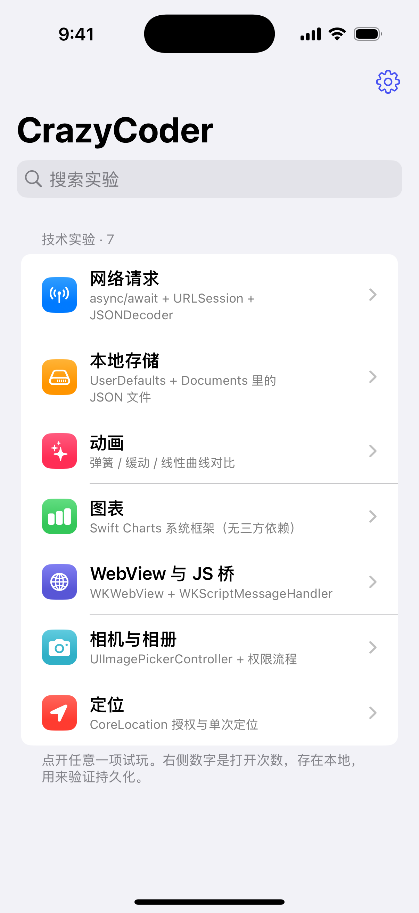
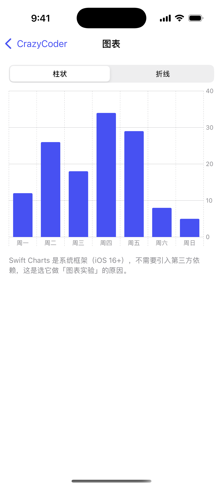
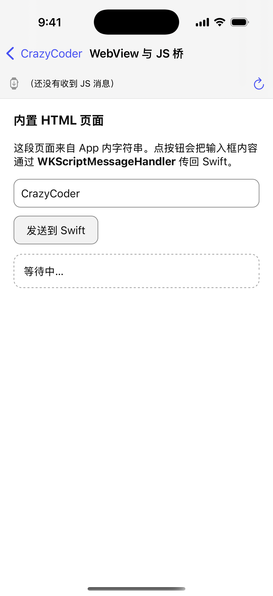

# CrazyCoder

**一个开源的 iOS「技术试验田」** —— 把想试的技术一个个做成可点开的小实验，装上手机随时验证，不用每次开新工程。

| | |
|---|---|
| 平台 | iOS 16.0+ / iPhone |
| 技术栈 | SwiftUI + Apple 系统框架（**零第三方依赖**）|
| 工程 | [XcodeGen](https://github.com/yonaskolb/XcodeGen)，`.xcodeproj` 不入库 |
| 构建 | GitHub Actions `macos-15`（公开仓库免费）|
| 许可证 | MIT |

---

## 界面

下面这些图不是设计稿，是 CI 在 macOS 模拟器里**把 App 真跑起来**截的（`screenshots.yml`）：

| 首页 | 图表 | WebView + JS 桥 |
|---|---|---|
|  |  |  |

全部截图见 [`docs/screenshots/`](docs/screenshots/)（共 9 张，含每个实验页与设置页）。

---

## 一、现在能试什么

| 实验 | 演示的技术 | 关键点 |
|---|---|---|
| 网络请求 | `async/await`、`URLSession`、`Codable` | 请求 `api.github.com/rate_limit`，无需登录 |
| 本地存储 | `UserDefaults`、Documents 里的 JSON 文件 | 记录数与文件字节数实时可见 |
| 动画 | `withAnimation` 三种曲线 | 弹簧 / 缓动 / 线性同动作对比 |
| 图表 | Swift Charts | iOS 16+ 系统框架，柱状 / 折线切换 |
| WebView 与 JS 桥 | `WKWebView` + `WKScriptMessageHandler` | 内置 HTML，双向通信 |
| 相机与相册 | `UIImagePickerController` + 权限流程 | 模拟器无相机，会走降级提示 |
| 定位 | CoreLocation 授权 + `requestLocation` | 首次弹权限框，状态实时显示 |
| 设置 | 主题持久化、版本信息 | 主题存 `UserDefaults`，杀进程后仍在 |

首页列表会统计每个实验被打开的次数，**这个计数本身就是持久化的活体验证**。

## 二、加一个新实验（3 个文件）

以「加一个 ARKit 实验」为例：

1. `App/Support/LabItem.swift`
   - `Kind` 里加 `case arkit`
   - `catalog` 里加一条（标题、副标题、SF Symbol、颜色、搜索关键词）
2. `App/Experiments/ARKitLabView.swift` 新建视图（`NavigationStack` 里会自带返回）
3. `App/ContentView.swift` 的 `LabDestination` 里加 `case .arkit: ARKitLabView()`

需要新权限就加 `App/Info.plist` 的 `NS*UsageDescription`；
需要新系统框架一般直接 `import` 即可（系统框架自动链接），只有三方包才动 SPM。

## 三、本地开发

本项目的思路是 **Windows 上只写代码，Mac 算力交给 CI**。要在本地跑，你需要一台 macOS：

```bash
brew install xcodegen          # 只需一次
xcodegen generate              # 由 project.yml 生成 CrazyCoder.xcodeproj
open CrazyCoder.xcodeproj      # Xcode 里选模拟器 ⌘R
```

改工程配置只改 `project.yml`，**不要手改 `.xcodeproj`**（它已被 `.gitignore` 挡住，本来也不入库）。

## 四、CI：打标签即发版

```bash
git tag v1.0.0
git push origin v1.0.0        # 自动出正式包 → 上传 TestFlight
```

只验证编译、不发版：

```bash
gh workflow run build.yml -f build_type=2
```

| 触发 | 行为 |
|---|---|
| push tag `v*` | 版本号取标签名，强制正式包，上传 TestFlight |
| 手动 `workflow_dispatch` | 按 `build_type` 出包（0 开发 / 1 AdHoc / 2 正式）|
| push 到 `main` | 跑 `compile.yml` **编译检查**：模拟器编译、不签名、零 Secrets，3–5 分钟 |
| push 改动 `App/` | 跑 `screenshots.yml`：**装进模拟器真跑**并逐页截图，同样零 Secrets |
| 其它分支 push | 不触发（PR 会触发编译检查）|

三个 workflow 分工：`compile.yml` 回答"编不编得过"，`screenshots.yml` 回答"跑不跑得起来、界面对不对"，
`build.yml` 回答"能不能出包"。日常改完先看前两个，都绿了再打标签，能省掉大量"等 10 分钟才知道崩了"。

构建产物在 Actions 的 Artifacts 里：`CrazyCoder-ipa` 与 `CrazyCoder-dsym`。

> **dSYM 一定要留**：崩溃日志没有它就没法符号化。

## 五、仓库需要的 5 个 Secrets

在 *Settings → Secrets and variables → Actions* 配置（或命令行，见 `scripts/`）：

| Secret | 内容 |
|---|---|
| `CERTIFICATE_BASE64` | Apple Distribution 证书 `.p12` 的 base64（单行，无换行）|
| `P12_PASSWORD` | 上面 `.p12` 的导出密码 |
| `PROVISIONING_PROFILE` | App Store 描述文件 `.mobileprovision` 的 base64 |
| `KEYCHAIN_PASSWORD` | CI 临时钥匙串密码，随便一个字符串 |
| `DEVELOPMENT_TEAM` | 10 位 Team ID |

要上传 TestFlight 还需要三个：`ASC_KEY_ID`、`ASC_ISSUER_ID`、`ASC_KEY_P8`。

**签名资产永远不要入库。** `.gitignore` 已挡住 `certs/`、`*.p12`、`*.mobileprovision`、`*.p8`；
一旦误传，光删文件没用，历史里还在 —— 立刻去 Apple 后台吊销重建。

### 5.1 新账号第一次接入签名

> 这一段只做一次。**必须用你自己的开发者账号**（个人账号 $99/年），
> 不要借用所在公司的组织账号 —— 那样 App 的卖家、Team、协议归属都会变成公司。

1. **注册 App ID**：Apple Developer → Identifiers → `+` → App IDs，
   Bundle ID 填 `com.crazycoder.app`（与 `project.yml` 严格一致）
2. **建描述文件**：Profiles → `+` → *App Store* → 选上面那个 App ID →
   选你的 Apple Distribution 证书 → 命名 **`CrazyCoder AppStore`**（`build.yml` 里 `PROFILE_NAME` 用的就是这个名字）
3. **导出证书**：Certificates → Apple Distribution → 下载后双击进钥匙串 → 导出 `.p12`（设个密码）
4. **拿 Team ID**：开发者后台右上角，10 位大写字母数字
5. **写进仓库 Secrets**（一次搞定，不用手工 base64）：

```powershell
.\scripts\setup_secrets.ps1 `
    -Repo jiangsheng5221/CrazyCoder `
    -P12         certs\distribution.p12 `
    -P12Password '导出时设的密码' `
    -Profile     certs\CrazyCoder.mobileprovision `
    -TeamID      你的TeamID
```

加 `-AscKey certs\AuthKey_XXXXXXXXXX.p8 -AscKeyID XXX -AscIssuerID XXX` 就顺带配好 TestFlight 上传三件套。

**没配签名之前**：`compile.yml` 照样能跑（模拟器编译不签名），代码质量不受影响，只是出不了 `.ipa`。

### 5.2 不想在后台点？用脚本全自动建

`scripts/provision_apple.py` 走 App Store Connect API，把 5.1 里前三步（建 App ID、签证书、建描述文件）一次做完：

```powershell
# ① 先只验证凭据和账号现状，不创建任何东西
python scripts\provision_apple.py --dry-run `
    --key-id ABCDE12345 --issuer 00000000-0000-0000-0000-000000000000 `
    --p8 certs\AuthKey_ABCDE12345.p8 --team 你的TeamID

# ② 确认无误后正式创建
python scripts\provision_apple.py `
    --key-id ABCDE12345 --issuer 00000000-0000-0000-0000-000000000000 `
    --p8 certs\AuthKey_ABCDE12345.p8 --team 你的TeamID
```

它会生成 `certs/distribution.p12` 和 App Store 描述文件，并**打印出可直接粘贴的 `setup_secrets.ps1` 命令**。

- 密钥在 *App Store Connect → 用户和访问 → 集成 → App Store Connect API* 生成，角色需 **Admin**
- 脚本会在本地生成私钥和 CSR 再提交，私钥始终不出本机
- `--self-test` 可以不联网自检 JWT 签名与 p12 打包
- Apple 分发证书上限 3 张，已满会报 409，需要先去后台吊销一张旧的

## 六、目录结构

```
CrazyCoder/
├── .github/workflows/
│   ├── build.yml                 # 正式构建：签名 → ipa → TestFlight
│   ├── compile.yml               # 编译检查：模拟器、不签名、零 Secrets
│   └── screenshots.yml           # 模拟器实跑 + 逐页截图
├── App/
│   ├── CrazyCoderApp.swift       # @main
│   ├── ContentView.swift         # 实验清单 + 路由
│   ├── SettingsView.swift        # 设置
│   ├── Experiments/              # 每个技术一个文件
│   ├── Support/                  # LabItem 目录、LabStore 状态、AppInfo
│   ├── Info.plist
│   └── Assets.xcassets/          # AppIcon、AccentColor
├── docs/screenshots/             # CI 跑出来的截图
├── scripts/
│   ├── precheck.py               # 本地预检（上 CI 前先跑它）
│   ├── provision_apple.py        # 用 ASC API 自动建 App ID/证书/描述文件
│   ├── setup_secrets.ps1         # 一键配置 5 个签名 Secrets
│   ├── push_via_api.py           # git push 不通时的备用提交通道
│   └── make_icon.py              # 重新生成图标
├── project.yml                   # xcodegen 工程定义
├── RELEASE_NOTES.md
└── README.md
```

## 七、上 CI 之前先本地预检

```bash
python scripts/precheck.py
```

五项：workflow 防护、Bundle ID 一致性、Info.plist 合规、工作区是否干净、证书有效期。
macOS runner 一次构建 6–12 分钟，能本地挡住的错误别浪费在 CI 上。

## 八、许可证

MIT，见 [LICENSE](LICENSE)。
